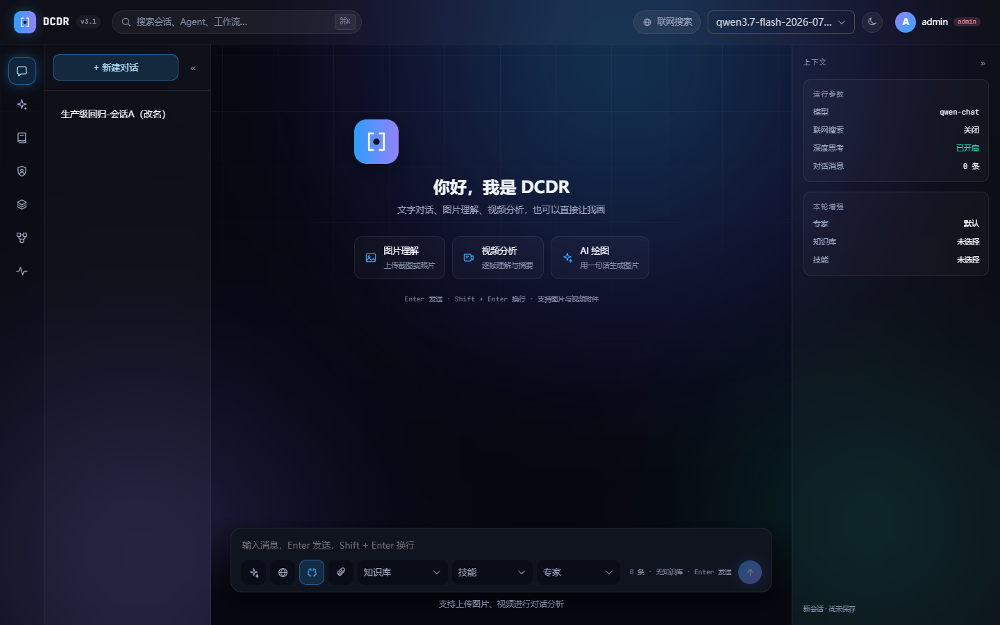
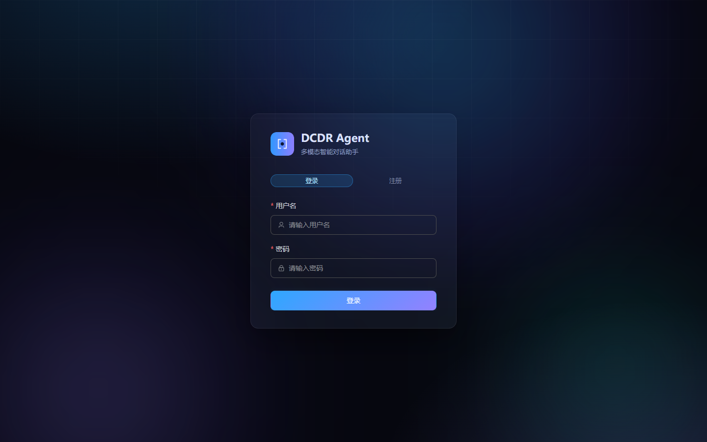
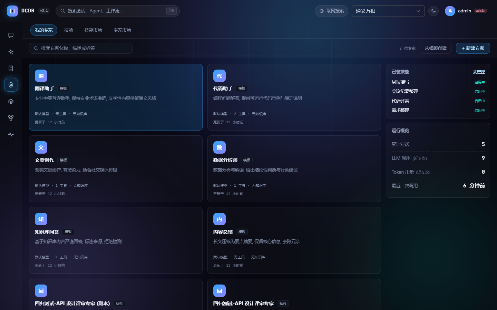
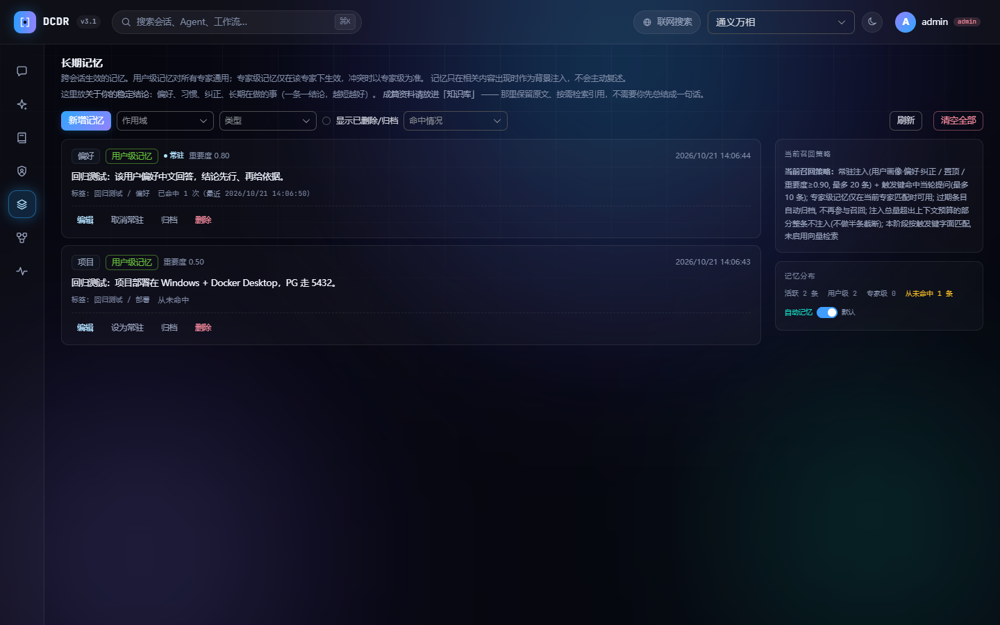
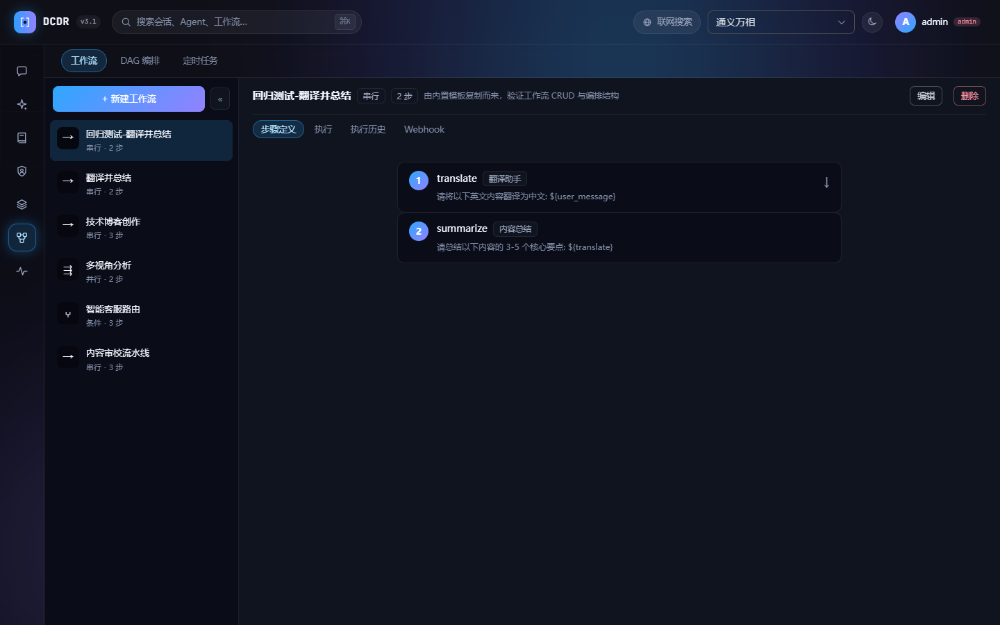
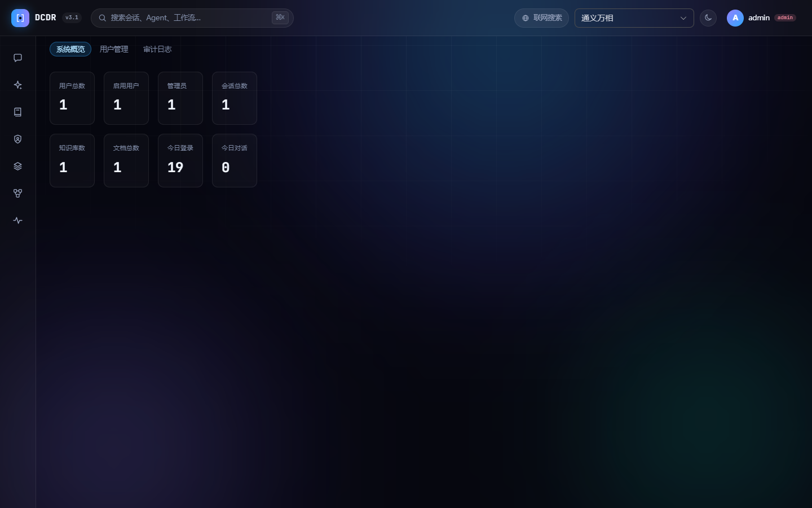

# 一人公司多模态 AI 助手工作台

<div align="center">

**基于 Spring Boot 3 + Java 17 + LangChain4j 的生产级 Agent 平台**

智能路由 · 可视化 DAG 编排 · 执行容错 · 知识库 RAG · 多模态生成 · 链路追踪与治理

[](https://www.oracle.com/java/)
[](https://spring.io/projects/spring-boot)
[](https://docs.spring.io/spring-framework/reference/web/webflux.html)
[](https://docs.langchain4j.dev/)
[](https://vuejs.org/)
[](https://vitejs.dev/)
[](https://www.postgresql.org/)
[](https://redis.io/)
[](https://docs.docker.com/compose/)
[](LICENSE)

</div>



---

## 一、5 分钟跑起来

### 1.1 环境要求

| 组件 | 版本要求 | 用途 | 是否必需 |
|---|---|---|---|
| JDK | **17**（Spring Boot 3 要求） | 编译运行后端 | 必需 |
| Maven | 3.8+ | 构建 | 必需 |
| Docker + Compose | 20.10+ / compose v2 | 跑 PostgreSQL / Redis 等依赖 | 必需（也可用本机安装的 PG/Redis） |
| Node.js | **18+**（推荐 20 / 22） | 前端构建，Vite 5 不支持 Node 16 | 仅前端需要 |
| PostgreSQL | 16 + pgvector 扩展 | 业务库 + 向量库 | 由 compose 提供 |
| Redis | 7 | 限流计数 / 定时任务租约锁 | 由 compose 提供 |

默认端口占用：`8080`（后端）· `5173`（前端）· `5432`（PG）· `6379`（Redis）· `9411`（Zipkin）· `8888`（SearXNG）· `18080`（沙箱服务端）。

> 只装 Docker 不装 JDK 也能跑：见 1.5 纯容器方式。

### 1.2 第一步：生成两项必需密钥

启动期 `SecretGuard` 会校验密钥，**为空或使用内置默认值会直接拒绝启动**（公开可知的 JWT 密钥 =
任何人都能伪造 admin 的 Token）。

```bash
# 项目根目录创建 .env（已被 .gitignore 忽略；本地运行与 docker compose 都会自动读取）
JWT_SECRET=<64 位随机十六进制>
MODEL_API_KEY_SECRET=<另一份 64 位随机十六进制，不要复用>
```

生成随机值：

```powershell
# Windows PowerShell
[guid]::NewGuid().ToString('N') + [guid]::NewGuid().ToString('N')
```

```bash
# Linux / macOS / Git Bash
openssl rand -hex 32
```

### 1.3 第二步：启动依赖（PostgreSQL / Redis / Zipkin / SearXNG）

```bash
docker-compose -f docker-compose.yml up -d          # 只起中间件，应用在本机跑
docker ps             # 等 postgres、redis 变成 healthy
```

首次建库时 `docs/sql/v2.0|v3.0|v3.1_schema.sql` 会被自动执行，**无需手工建表**。

### 1.4 第三步：启动后端

```bash
mvn -q compile -DskipTests    # 首次会下载依赖
mvn spring-boot:run           # 默认 profile=pg，连本机 5432
```

看到 `Netty started on port 8080` 即成功。此时：

- 接口文档：<http://localhost:8080/swagger-ui/index.html>
- 健康检查：<http://localhost:8080/actuator/health>（**返回 DOWN 是预期**：见「九、已知限制」）

### 1.5 第四步：启动前端

```bash
cd frontend
npm install
npm run dev                   # http://localhost:5173，已配好 /api 代理
```

> **Node 版本**：必须是 18+。Node 16 会报 `TypeError: crypto$2.getRandomValues is not a function`
> —— Node 16 的 `globalThis.crypto` 没有 WebCrypto 的 `getRandomValues`，而 Vite 5.4 需要它。
> 本机没装 nvm 时可用仓库内脚本（把便携版 Node 22 前置到 PATH，不改系统环境）：
>
> ```bat
> cd frontend
> dev.cmd          :: 启动开发服务器
> build.cmd        :: 生产构建
> node22.cmd       :: 打开一个已切到 Node 22 的命令行（装依赖用）
> ```

### 1.6 第五步：注册管理员

浏览器打开 <http://localhost:5173> → 「注册」→ 填用户名密码。

**空库的第一个注册用户自动成为 `admin`**（`AuthService`：`count()==0 ? admin : user`），
仓库不预置任何默认账号。

### 1.7 纯容器方式（不装 JDK）

```bash
docker compose up -d                                   # 1) 中间件
docker compose -f docker-compose.app.yml up -d --build # 2) 应用（含前端静态资源）
```

应用容器与依赖通过固定网络 `dcdr-net` 互通，容器内按服务名访问 `postgres:5432` / `redis:6379`。
详见 [`docs/18-本地运行与部署教程.md`](docs/18-本地运行与部署教程.md)。

### 1.8 想接入真实模型？

在 `.env` 里补上对应厂商的 Key（`DASHSCOPE_API_KEY` / `DEEPSEEK_API_KEY` / `OPENAI_API_KEY` /
`ZHIPU_API_KEY` / `KLING_API_KEY`），重启后端即可。不配 Key 时接口都能通，但
**对话、向量化、检索、图片生成会调用失败**——这是外部依赖缺失，不是应用缺陷。

---

## 二、产品截图

> 以下截图取自本仓库的真实运行实例（PostgreSQL 中有真实测试数据，非设计稿、非 mock）。

| 登录 / 注册 | 对话工作台 |
|---|---|
|  |  |

| 专家工作台（我的专家 / 技能 / 技能市场 / 专家市场） | 长期记忆 |
|---|---|
|  |  |

| 自动化（工作流 / DAG 编排 / 定时任务） | 管理后台（系统概览 / 用户 / 审计） |
|---|---|
|  |  |

更多截图：`docs/images/03-creative.png`（创作）· `04-knowledge.png`（知识库与检索测试）· `08-ops.png`（运维监控与成本）。

---

## 三、版本

| 项 | 值 |
|----|----|
| 当前版本 | **v3.2.0-ui**（UI 版，后端能力同 v3.1.0） |
| 发布日期 | 2026-10-21 |
| Java | 17 |
| Spring Boot | 3.3.5 |
| AI 框架 | LangChain4j 1.19.0 |
| 构建工具 | Maven |
| 自动化测试 | 392 条单元/装配测试，全部通过 |

> 版本演进：V1.x（单轮对话）→ V2.0（知识库 / 认证 / 多 Agent）→ V2.1（RAG 增强）→ V2.2（RBAC / 审计 / 数据隔离）→ V2.3（自定义 Agent / 工作流 / 定时任务 / 流式图片）→ V3.0（智能路由 / 可视化 DAG / 执行容错 / LangChain4j 框架化 / 治理可观测）→ **V3.1（统一归属框架 / 专家与技能体系 / 代码执行沙箱 / 版本与成本治理 / 多实例协调 / 长期记忆）** → **V3.2.0-ui（设计令牌与 EP 覆盖层 / 深浅双主题 / 全站界面重构 / 编排拆分）**。发布说明见 [`docs/RELEASE-v3.2.0-ui.md`](docs/RELEASE-v3.2.0-ui.md)。

---

## 四、特性总览

### 对话与多模态
- 流式对话（SSE），支持上下文记忆与多轮会话
- **图像生成 / 视频生成**（按模型 `type` 分类：`CHAT` / `IMAGE` / `VIDEO`）
- **音频生成**（TTS）与音频文件处理
- 内置工具：计算器、时间、天气、图像生成、**自建联网搜索**（SearXNG + 正文提取）、
  **长期记忆读写**（`memory` 工具）、**代码执行沙箱**（`code_interpreter`）、MCP 工具注册（`ToolRegistry`）

### 知识库 (RAG)
- 知识库管理（用户级 / 公开级可见性），文档上传 → 分块 → 向量化 → 相似度检索（`rag/` 模块）
- **混合检索**（向量 + BM25 全文，RRF 融合）与可选**相关性重排**；Agentic 检索（模型自主调用 `knowledge_base_search`）
- 注入加固（边界标记 / 长度预算）与**引用忠实度校验**（回答中的 `[[n]]` 必须落在本次来源集内）

### 自定义 Agent 与编排
- Agent 定义：系统提示词、绑定模型、工具列表 (`tools`)、关联知识库 (`kbIds`)、温度参数
- 公开 / 模板 Agent (`isPublic` / `isTemplate`)，支持克隆
- **智能路由**（LLM 意图识别）：对话即自动触发工作流 / Agent，低置信度自动回退，路由日志可查
- **可视化 DAG 编排**（拖拽画布 + 路由节点）与表单式工作流、定时任务调度
- **执行容错**：失败重试（fixed / linear / exponential 退避）、断点续跑、人工审批节点
- **模板市场**：Agent / 工作流模板一键套用

### 治理与可观测
- LLM 调用链路追踪（Micrometer Tracing + Zipkin），traceId 贯穿日志
- 监控视图（MonitorView）、Actuator 健康检查、Prometheus 指标
- 限流（RateLimitWebFilter）与模型调用熔断（CircuitBreakerChatProvider）
- 成本与配额：对话 token 用量记录、用户级配额检查（超额 429）
- 审计日志、日志轮转（100MB / 文件，保留 30 天 / 总量 2GB）

### 多用户与协作
- 基于 Token 的认证（`auth/` 模块 + `SecurityContextWebFilter` 请求级身份注入）
- RBAC 权限模型（admin / user / guest，`Permission.java` 角色-权限映射）
- 基于用户 / 可见性的数据隔离（Repository 按 `userId` / `visibility` 过滤）
- 管理员后台（用户管理、审计日志 `audit/`）

### V3.1 新增
- **长期记忆**：分层作用域（用户级 / Agent 级）+ 常驻与关键词触发召回 + 过期归档；对话内「请记住 X」
  （`memory` 工具）与 **LLM 自动抽取**（两层开关：部署闸门 + 用户同意），记忆页可见、可改、可溯源
- **专家与技能体系**：技能定义 / 技能市场（SkillHub 发现层）/ 专家工作台（专家·自动化·运维三个 Hub）
- **统一归属框架**（`auth/ownership`）：14 类资源的越权收口，声明式 `@PreAuthorize` 接入，越权统一 404
- **代码执行沙箱**：受控容器运行 Python（禁网 / CPU 内存配额 / 双超时 / 非 root / 全局并发上限）
- **治理**：Agent 版本快照 / 结构化 diff / 回滚，成本分析报表与 CSV 导出
- **多实例协调**：集中式限流（Redis）+ 定时任务租约锁
- **回答反馈**：点赞 / 点踩 + 差评归因看板；**用户自定义模型**（Key 加密存储）；检索健康度看板

---

## 五、技术栈

| 层 | 技术 |
|----|------|
| 后端 | Spring Boot 3.3.5 · WebFlux (响应式) · Java 17 |
| AI 框架 | LangChain4j 1.19.0（core）+ 1.19.0-beta29（社区集成，含 DashScope） |
| 持久化 | Spring Data JPA · PostgreSQL 16 + pgvector（H2 仅作测试替身） · Redis 7 |
| 检索 | pgvector 余弦 + BM25 全文，RRF 融合 + 可选重排 |
| 可观测 | Micrometer Tracing · Zipkin · Prometheus · Actuator |
| 前端 | Vue 3 · Vite 5 · Element Plus · Pinia · ECharts |
| 沙箱 | opensandbox-server（自托管，业务侧零特权） |
| 部署 | Docker · docker-compose（依赖与应用分离编排） |

---

## 六、目录结构

```
dcdr-agent/
├── pom.xml                        # Maven 构建 (JDK 17, v3.1.0)
├── Dockerfile / .dockerignore     # 多阶段构建; 凭据不进构建上下文
├── docker-compose.yml             # 只含依赖: postgres / redis / zipkin / searxng / opensandbox-server
├── docker-compose.app.yml         # 只含应用: agent（接入 dcdr-net 网络）
├── docker-compose.ha.yml          # 多实例 + PG 主从（叠加文件, profile: ha）
├── docker/                        # nginx(SSE 反代) / pg-standby / searxng 配置
├── scripts/                       # 运维脚本（索引见 scripts/README.md）
│   ├── backup-db.ps1              # PG 全量备份（每日 02:00）
│   ├── restore-db.sh              # 备份恢复（演练/灾备）
│   └── ha-standby-init.ps1        # 主从演练前置：复制角色 + pg_hba
├── tests/
│   ├── api-smoke.mjs              # 生产级接口回归（真实 HTTP，不 mock）
│   ├── fixtures/                  # 回归用固定素材
│   └── results/                   # 每次回归的逐条结果 JSON
├── docs/                          # 需求 / 规划 / 发布说明 / SQL / 教程 / 测试报告
│   ├── 18-本地运行与部署教程.md     # ← 从零跑起来 / Docker 部署 / 升级 / 常见问题
│   ├── 19-生产级测试报告-v3.2.md    # ← 本轮回归的范围、结果、缺陷与限制
│   ├── images/                    # 产品截图
│   ├── sql/                       # v2.0 / v3.0 / v3.1 建库脚本
│   └── eval/                      # memory-health / retrieval-health 巡检 SQL
├── src/main/java/com/dcdr/agent/
│   ├── controller/                # REST 接口（29 个控制器 / ~150 端点）
│   ├── agent/                     # 编排核心 / 路由 / 定义与版本 / 工作流 / 记忆 / 治理 / 反馈
│   ├── skill/  rag/  auth/  cluster/  tool/  model/
│   ├── entity/ dto/ repository/
│   └── service/ config/ common/ admin/ audit/
├── src/test/                      # 392 条单元/装配测试 + 5 个 *IT 集成测试
└── data/                          # 运行时数据（文档/上传/生成物/备份），已 gitignore
```

---

## 七、主要 API

| 模块 | 路径 | 说明 |
|------|------|------|
| 认证 | `/api/auth` | 登录 / 注册 / 刷新 / 改密；JWT 双 Token（Access 24h / Refresh 7d） |
| 对话 | `POST /api/chat` `/api/chat/stream` | 同步对话 / SSE 流式（含智能路由分发） |
| 会话 | `/api/sessions` | 会话增删改查、人设、消息历史、导出 Markdown/JSON |
| Agent | `/api/agents` | 自定义 Agent 增删改查、克隆、模板、版本与回滚 |
| 知识库 | `/api/knowledge-bases` | 知识库与文档管理、单库/跨库检索（RAG） |
| 工作流 | `/api/workflows` | 工作流定义、DAG 编排、执行 / 续跑 / 审批 |
| 定时任务 | `/api/scheduled-tasks` | Cron 调度（需 `schedule:manage`） |
| 智能路由 | `/api/routing` | 路由日志分页查询 |
| Webhook | `/api/webhooks` | 端点管理与外部触发（`POST /trigger/{token}` 公开） |
| 多模态 | `/api/images` `/api/videos` `/api/audio` | 图像 / 视频 / 音频生成与状态查询 |
| 模型 | `/api/models` `/api/user-models` | 平台内置模型 + 用户自定义模型（Key 加密存储） |
| 长期记忆 | `/api/memories` | 记忆 CRUD / 概览 / 归档恢复 / AI 自动记忆开关 |
| 技能 | `/api/skills` `/api/skill-market` | 技能定义管理 / 技能市场（分类·搜索·安装） |
| 回答反馈 | `/api/feedback` | 点赞 / 点踩采集与看板统计 |
| 治理 | `/api/monitor/*` `/api/retrieval-health/overview` | 成本报表（CSV 导出）/ 检索健康度 |
| 管理后台 | `/api/admin` `/api/tenants` | 用户管理 / 租户配额（仅 `user:manage`） |

---

## 八、测试

```bash
# 1) 单元 + 装配测试（零外部依赖，约 1 分钟；需要 Docker 的用例会自行跳过）
mvn test

# 2) 生产级接口回归（需先启动后端与依赖；创建的数据会真实落库并保留）
TEST_USER=admin TEST_PASS='<你的密码>' node tests/api-smoke.mjs

# 3) 集成测试（需 Docker；部分用例需要 DASHSCOPE_API_KEY，缺失时自动跳过）
mvn verify
```

回归脚本覆盖 51 条用例，逐条记录 HTTP 状态、业务码、耗时与判定，结果落 `tests/results/*.json`。
本轮实测结论、缺陷与未覆盖项见 [`docs/19-生产级测试报告-v3.2.md`](docs/19-生产级测试报告-v3.2.md)。

---

## 九、已知限制

- **`/actuator/health` 返回 DOWN**：`LlmProviderHealthIndicator` 会在 3 秒内探测所有启用的远程
  模型 provider，**全部不可达即判 DOWN**。不配 Key / 无外网时必然 DOWN，不代表应用不可用；
  业务接口可正常访问。生产部署建议把它从 readiness 里拆出去，避免被负载均衡摘除。
- **不配模型 Key 时**：对话返回 `code=200` 但正文是 `调用失败: ...`；知识库文档状态为
  `failed`（`error_msg` 记录厂商报错）；检索返回 500。这些都是外部依赖缺失。
- **技能市场**依赖外部 SkillHub 可达，内网/代理环境下会返回 504。

---

## 十、相关文档

- 需求文档：`docs/01-需求文档.md`
- **本地运行与部署教程**：`docs/18-本地运行与部署教程.md`
- **生产级测试报告**：`docs/19-生产级测试报告-v3.2.md`
- 运维脚本索引：`scripts/README.md`
- V3.1 规划：`docs/14-V3.1规划文档.md`（V3.0 见 `docs/07-V3.0规划文档.md`）
- 发布说明：`docs/RELEASE-v3.2.0-ui.md`（历史版本见 `docs/RELEASE-*.md`）

---

## 十一、License

[MIT](LICENSE)
